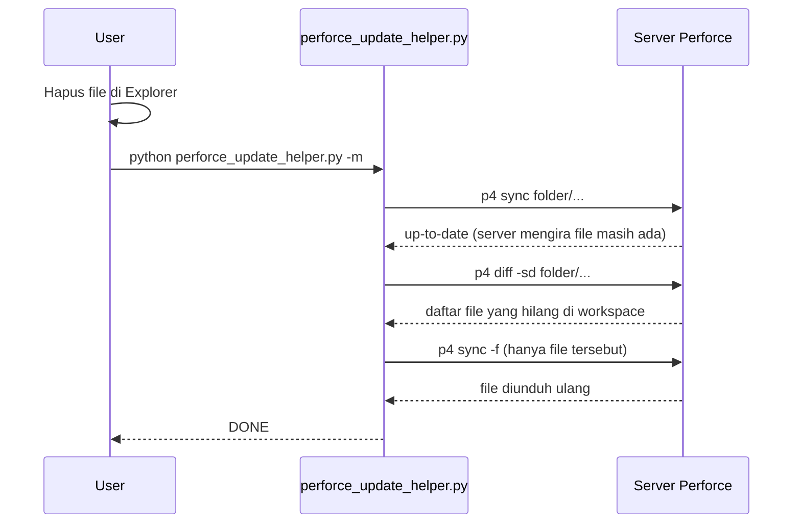

# Perforce Update Helper

Script Python untuk mengambil revisi terbaru dari sebuah folder Perforce dengan satu perintah, tanpa perlu klik-klik manual di P4V.

> Developed by **ardi.putra** with full AI coding assistance.

---

## 1. Latar Belakang Masalah

### Cara lama (manual)

Untuk mendapatkan file terbaru dari Perforce, langkahnya biasanya seperti ini:

1. Buka **P4V**.
2. Pastikan workspace yang aktif sudah benar.
3. Cari folder yang dibutuhkan di tab _Depot_ atau _Workspace_.
4. Klik kanan folder, pilih **Get Latest Revision**.
5. Kalau ada file yang terhapus di lokal dan tidak ikut terunduh, ulangi dengan **Get Revision > Force Operation**, yang mengunduh ulang semuanya (lama).

Langkah ini harus diulang setiap kali butuh update, dan mudah salah (salah workspace, salah folder, lupa force, dan lain-lain).

### Masalah tambahan: file terhapus di lokal tidak ikut terunduh

Perforce menyimpan catatan di server tentang file dan revisi apa saja yang sudah ada di workspace kamu (_have list_). Kalau sebuah file dihapus **lewat Explorer** (bukan lewat Perforce), server tidak tahu dan tetap mengira file itu ada. Akibatnya `Get Latest` / `p4 sync` biasa menjawab _up-to-date_ dan file yang hilang tidak diunduh ulang.

### Solusi

Perforce Update Helper mengotomatiskan seluruh proses di atas:

- **Satu perintah** (atau satu klik kalau dibuatkan shortcut) untuk sync folder ke revisi terbaru.
- Bisa dijalankan **otomatis** lewat Task Scheduler.
- Opsi **`restore-missing`** yang hanya mengunduh ulang file yang terhapus di lokal, tanpa mengunduh ulang semua file.
- Semua setting disimpan di bagian atas script, jadi tidak perlu mengetik argumen berulang.
- Pengecekan awal (login, workspace) dengan pesan error dan _hint_ yang jelas.

---

## 2. Fungsi

| Fungsi                     | Keterangan                                                                    |
| -------------------------- | ----------------------------------------------------------------------------- |
| Sync ke revisi terbaru     | `p4 sync <depot>/...#head`                                                    |
| Sync ke revisi tertentu    | Changelist (`@12345`) atau tanggal (`@2026/10/27`)                            |
| Preview                    | Menampilkan apa yang akan dilakukan tanpa mengunduh apa pun                   |
| Restore file yang terhapus | Mendeteksi file hilang di lokal (`p4 diff -sd`) lalu mengunduh hanya file itu |
| Force resync               | Mengunduh ulang semua file dan menimpanya (hati-hati)                         |
| Checkout untuk edit        | `p4 edit` semua file di folder setelah sync (opsional)                        |
| Validasi awal              | Cek koneksi, login, dan workspace sebelum sync                                |
| Hint error                 | Petunjuk otomatis untuk error umum (SSL, login, workspace, koneksi)           |

---

## 3. Persiapan

### Kebutuhan

- Python 3.9 atau lebih baru (cek: `python --version`)
- Perforce CLI (`p4`) terinstall dan bisa dipanggil dari terminal (cek: `p4 -V`)
- Sudah punya workspace (client) Perforce

### Cek `p4` sudah terkonfigurasi

```bash
p4 info
```

Kalau berhasil, akan tampil `User name`, `Client name`, `Server address`, dan lain-lain.

---

## 4. Cara Setting

Buka `perforce_update_helper.py` dan edit blok **SETTING DEFAULT** di bagian atas file.

### 4.1 Koneksi dan lokasi

Nilai di blok **SETTING DEFAULT** adalah nilai cadangan (default). Ada 2 cara memakainya:

1. Isi di script, lalu jalankan tanpa argumen: `python perforce_update_helper.py`
2. Kosongkan di script, lalu kirim lewat argumen: `python perforce_update_helper.py -d //depot/folder -c workspace` (argumen selalu menimpa nilai di script)

Yang **wajib** diisi (di script atau lewat argumen): `DEFAULT_DEPOT_PATH` / `-d`, dan `DEFAULT_CLIENT` / `-c` (kecuali `P4CLIENT` sudah ter-set di sistem, cek: `p4 set P4CLIENT`). Kalau client kosong dan `P4CLIENT` tidak ter-set, `p4` memakai nama komputer sebagai nama workspace dan akan error `Client 'NAMA-PC' unknown`. `USER` dan `PORT` boleh kosong kalau sudah ter-set di sistem (cek: `p4 set`).

| Setting              | Status                                          | Penjelasan                                                                                                                                                                                                                                                                                                                | Cara cari / info penting                                                                                                                                                                                                                                                                                                                                                                                                                                                                                                                                                                                         |
| -------------------- | ----------------------------------------------- | ------------------------------------------------------------------------------------------------------------------------------------------------------------------------------------------------------------------------------------------------------------------------------------------------------------------------- | ---------------------------------------------------------------------------------------------------------------------------------------------------------------------------------------------------------------------------------------------------------------------------------------------------------------------------------------------------------------------------------------------------------------------------------------------------------------------------------------------------------------------------------------------------------------------------------------------------------------- |
| `DEFAULT_DEPOT_PATH` | **Wajib**                                       | Path folder **di server** Perforce (diawali `//`), bukan path di komputer.<br>Contoh: `"//depot/project/folder"`<br>Jangan sertakan `/...` di belakang, script menambahkannya sendiri.                                                                                                                                    | **a) P4V:** klik kanan folder di tab "Depot" > Properties (atau lihat path di bagian atas tree), lalu salin path yang diawali `//`.<br>**b) Terminal:** lihat daftar depot dengan `p4 depots`, lalu telusuri folder dengan `p4 dirs "//namadepot/*"` dan `p4 dirs "//namadepot/folder/*"`.<br>**c) Kalau sudah tahu path lokalnya** (di komputer), tanya server: `p4 where "D:\path\lokal\folder\..."`. Kolom pertama hasilnya adalah depot path-nya.                                                                                                                                                            |
| `DEFAULT_USER`       | Opsional                                        | Username Perforce.<br>Kosong = pakai `P4USER` yang sudah ter-set (cek: `p4 set`).                                                                                                                                                                                                                                         | Terminal: `p4 info` (baris "User name").<br>P4V: Connection > Connection Info.                                                                                                                                                                                                                                                                                                                                                                                                                                                                                                                                   |
| `DEFAULT_CLIENT`     | **Wajib**<br>(kecuali `P4CLIENT` sudah ter-set) | Nama workspace (client) Perforce kamu.<br>Kosong = pakai `P4CLIENT` yang sudah ter-set (cek: `p4 set`).<br>Kalau muncul error `Client 'xxx' unknown`, artinya nama default dari hostname tidak ada di server, jadi isi nilai ini.                                                                                         | **a) P4V:** lihat dropdown "Workspace" di pojok kanan atas, atau tab Workspaces.<br>**b) Terminal:** `p4 clients -u USERNAME_KAMU`. Pilih yang kolom "root"-nya sama dengan folder lokal tempat file mau diunduh. (Kalau ada beberapa PC, pilih yang namanya sesuai PC yang sedang dipakai.)<br>**c) Yang sedang aktif sekarang:** `p4 info` (baris "Client name").                                                                                                                                                                                                                                              |
| `DEFAULT_PORT`       | Opsional<br>**Rekomendasi: kosongkan**          | Alamat server Perforce.<br>Kosong = pakai `P4PORT` yang sudah ter-set di sistem (cek: `p4 set P4PORT`), sama seperti yang dipakai P4V dan perintah `p4` lainnya di terminal.<br>Kalau `P4PORT` belum ter-set, atur sekali secara permanen (tidak perlu isi di script): `p4 set P4PORT=ssl:namaserver.perusahaan.com:1667` | **Info penting kalau mau mengisinya di script:**<br>- Formatnya harus lengkap: `host:port`, bukan port saja. Port saja (misal `"1667"`) dianggap localhost dan akan error "connection refused".<br>- Kalau server memakai SSL, **wajib** pakai prefix `ssl:`, contoh `"ssl:namaserver.perusahaan.com:1667"`. Tanpa itu muncul error "Failed client connect, server using SSL".<br>- Cek alamat server dengan `p4 info` (baris "Server address"), atau P4V > Connection > Connection Info.<br>- Pertama kali konek lewat SSL, mungkin perlu: `p4 trust -y`<br>- Kalau muncul error soal password/sesi: `p4 login` |
| `DEFAULT_REVISION`   | Opsional                                        | Revisi yang diambil.<br>`"#head"` = terbaru (default)<br>`"@12345"` = sampai changelist 12345<br>`"@2026/10/27"` = kondisi pada tanggal tersebut                                                                                                                                                                          | -                                                                                                                                                                                                                                                                                                                                                                                                                                                                                                                                                                                                                |

### 4.2 Opsi (`True` / `False`)

Semua opsi bersifat **opsional** (default `False`). Bisa ditimpa dari command line: pakai `--nama-opsi` untuk mengaktifkan, atau `--no-nama-opsi` untuk menonaktifkan (contoh: `--no-force`, `--no-preview`).

| Setting                   | Status                    | Default | Penjelasan                                                                                                                                                                                                                                                              | Argumen CLI                                         |
| ------------------------- | ------------------------- | ------- | ----------------------------------------------------------------------------------------------------------------------------------------------------------------------------------------------------------------------------------------------------------------------- | --------------------------------------------------- |
| `DEFAULT_PREVIEW`         | Opsional                  | `False` | Hanya tampilkan apa yang **akan** dilakukan, tanpa download apa pun.<br>Aman untuk coba-coba.                                                                                                                                                                           | `-n` / `--preview` / `--no-preview`                 |
| `DEFAULT_RESTORE_MISSING` | Opsional                  | `False` | Download ulang file yang terhapus di lokal.<br>Perlu karena kalau file dihapus manual (bukan lewat `p4`), server tetap mengira kamu masih punya file itu, jadi sync biasa bilang "up-to-date".                                                                          | `-m` / `--restore-missing` / `--no-restore-missing` |
| `DEFAULT_FORCE`           | Opsional<br>**Hati-hati** | `False` | Paksa download ulang **semua** file di folder, termasuk yang masih ada dan tidak berubah, lalu menimpanya tanpa pengecekan. Bisa lama di folder besar, dan file yang diubah lokal tanpa `p4 edit` akan tertimpa.<br>**Sebaiknya biarkan `False` kecuali memang perlu.** | `-f` / `--force` / `--no-force`                     |
| `DEFAULT_QUIET`           | Opsional                  | `False` | Kurangi output saat sync (`p4 sync -q`).                                                                                                                                                                                                                                | `-q` / `--quiet` / `--no-quiet`                     |
| `DEFAULT_EDIT`            | Opsional                  | `False` | Setelah sync, checkout (`p4 edit`) **semua** file di folder untuk diedit.<br>Biasanya tidak perlu untuk sekadar "ambil latest".                                                                                                                                         | `--edit` / `--no-edit`                              |

### 4.3 Setting `P4PORT` (sekali saja)

Lebih baik atur di sistem daripada di script:

```bash
p4 set P4PORT=ssl:namaserver.perusahaan.com:1667
```

Hal penting soal port:

- Format harus lengkap `host:port`. Port saja (misalnya `1667`) dianggap `localhost` dan error _connection refused_.
- Server SSL **wajib** memakai prefix `ssl:`. Tanpa itu error _Failed client connect, server using SSL_.
- Pertama kali konek lewat SSL mungkin perlu `p4 trust -y`.
- Kalau sesi login habis: `p4 login`.

### 4.4 Contoh konfigurasi siap pakai

```python
DEFAULT_DEPOT_PATH = "//depot/project/folder"
DEFAULT_USER = "nama.user"
DEFAULT_CLIENT = "nama.user_PC_project_1234"
DEFAULT_PORT = ""
DEFAULT_REVISION = "#head"

DEFAULT_PREVIEW = False
DEFAULT_RESTORE_MISSING = True   # otomatis kembalikan file yang terhapus
DEFAULT_FORCE = False
DEFAULT_QUIET = False
DEFAULT_EDIT = False
```

---

## 5. Cara Menjalankan

```bash
python perforce_update_helper.py                      # pakai semua setting di script
python perforce_update_helper.py -n                   # preview dulu
python perforce_update_helper.py -m                   # sync + kembalikan file yang terhapus
python perforce_update_helper.py -d //depot/folder2   # timpa depot path
python perforce_update_helper.py -r @12345            # sync ke changelist tertentu
python perforce_update_helper.py --no-restore-missing # matikan opsi yang di-set True di script
```

Argumen command line selalu menimpa nilai di script.

---

## 6. Menjadikannya Satu Klik / Otomatis

### Opsi A: Satu klik lewat file `.bat`

Buat `sync.bat` di folder yang sama dengan `perforce_update_helper.py`:

```bat
@echo off
cd /d "%~dp0"
python perforce_update_helper.py
pause
```

Klik dua kali `sync.bat` dan proses langsung jalan. `pause` menahan jendela supaya hasilnya bisa dibaca. Shortcut-nya bisa ditaruh di Desktop.

### Opsi B: Otomatis saat login / terjadwal (Task Scheduler)

1. Buka **Task Scheduler**, lalu **Create Basic Task**.
2. Pilih trigger (misalnya _When I log on_ atau harian jam tertentu).
3. Action: _Start a program_.
   - Program: `python`
   - Arguments: `C:\path\ke\perforce_update_helper.py -q`
   - Start in: `C:\path\ke\`
4. Untuk jalan otomatis, pastikan sesi login Perforce tidak kedaluwarsa. Tanyakan ke admin Perforce soal _ticket_ yang berumur panjang kalau perlu.

---

## 7. Flow Script


---

## 8. Cara Kerja `restore-missing`



---

## 9. Perbandingan Opsi Sync

| Kebutuhan                        | Perintah                              | Kecepatan            | Risiko                                          |
| -------------------------------- | ------------------------------------- | -------------------- | ----------------------------------------------- |
| Ambil update terbaru saja        | `python perforce_update_helper.py`    | Cepat                | Tidak ada                                       |
| Kembalikan file yang terhapus    | `python perforce_update_helper.py -m` | Cepat                | Tidak ada                                       |
| Samakan semua file dengan server | `python perforce_update_helper.py -f` | Lambat (unduh semua) | File yang diubah lokal tanpa `p4 edit` tertimpa |

Catatan: `-m` hanya mengembalikan file yang **terhapus**. File yang **diubah** lokal tanpa `p4 edit` tidak dideteksi oleh `-m`.

---

## 10. Troubleshooting

| Error                                               | Penyebab                                             | Solusi                                                   |
| --------------------------------------------------- | ---------------------------------------------------- | -------------------------------------------------------- |
| `Client 'NAMA-PC' unknown`                          | `DEFAULT_CLIENT` kosong dan `P4CLIENT` tidak ter-set | Isi `DEFAULT_CLIENT` atau jalankan `p4 set P4CLIENT=...` |
| `Failed client connect, server using SSL`           | `P4PORT` tanpa prefix `ssl:`                         | Gunakan `ssl:host:port`                                  |
| `TCP connect to 1667 failed` / `connection refused` | `P4PORT` hanya port, dianggap `localhost`            | Gunakan format `host:port` lengkap                       |
| `Perforce password (P4PASSWD) invalid or unset`     | Sesi login habis                                     | Jalankan `p4 login`                                      |
| Diminta trust fingerprint                           | Pertama kali konek via SSL                           | Jalankan `p4 trust -y`                                   |
| File yang dihapus tidak terunduh                    | Server mengira file masih ada (_have list_)          | Jalankan dengan `-m`                                     |
| `AttributeError: BooleanOptionalAction`             | Python di bawah 3.9                                  | Upgrade Python                                           |
| `'p4' is not recognized`                            | Perforce CLI belum ada di PATH                       | Install Helix CLI / tambahkan ke PATH                    |

---

## 11. Ringkasan

- Edit blok **SETTING DEFAULT** sekali, lalu cukup jalankan `python perforce_update_helper.py` (atau klik `sync.bat`).
- Atur `P4PORT` di sistem, biarkan `DEFAULT_PORT` kosong.
- Aktifkan `DEFAULT_RESTORE_MISSING = True` agar file yang terhapus di lokal otomatis dikembalikan.
- Hindari `DEFAULT_FORCE = True` kecuali benar-benar perlu.
