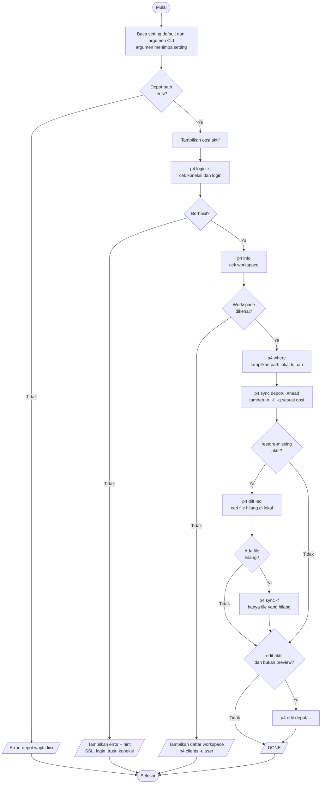
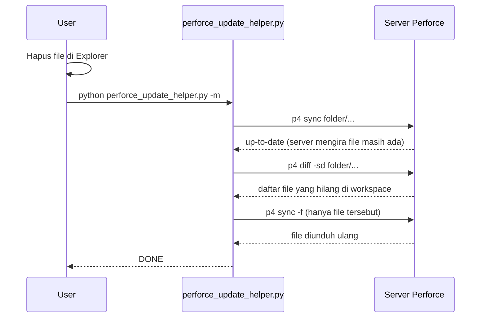

# Perforce Update Helper

Script Python untuk mengambil revisi terbaru dari sebuah folder Perforce dengan satu perintah, tanpa perlu klik-klik manual di P4V.

> Developed by **ardi.putra** with full AI coding assistance.

---

## 1. Latar Belakang Masalah

### Cara lama (manual)

Untuk mendapatkan file terbaru dari Perforce, langkahnya biasanya seperti ini:

1. Buka **P4V**.
2. Pastikan workspace yang aktif sudah benar.
3. Cari folder yang dibutuhkan di tab *Depot* atau *Workspace*.
4. Klik kanan folder, pilih **Get Latest Revision**.
5. Kalau ada file yang terhapus di lokal dan tidak ikut terunduh, ulangi dengan **Get Revision > Force Operation**, yang mengunduh ulang semuanya (lama).

Langkah ini harus diulang setiap kali butuh update, dan mudah salah (salah workspace, salah folder, lupa force, dan lain-lain).

### Masalah tambahan: file terhapus di lokal tidak ikut terunduh

Perforce menyimpan catatan di server tentang file dan revisi apa saja yang sudah ada di workspace kamu (*have list*). Kalau sebuah file dihapus **lewat Explorer** (bukan lewat Perforce), server tidak tahu dan tetap mengira file itu ada. Akibatnya `Get Latest` / `p4 sync` biasa menjawab *up-to-date* dan file yang hilang tidak diunduh ulang.

### Solusi

Perforce Update Helper mengotomatiskan seluruh proses di atas:

- **Satu perintah** (atau satu klik kalau dibuatkan shortcut) untuk sync folder ke revisi terbaru.
- Bisa dijalankan **otomatis** lewat Task Scheduler.
- Opsi **`restore-missing`** yang hanya mengunduh ulang file yang terhapus di lokal, tanpa mengunduh ulang semua file.
- Semua setting disimpan di bagian atas script, jadi tidak perlu mengetik argumen berulang.
- Pengecekan awal (login, workspace) dengan pesan error dan *hint* yang jelas.

---

## 2. Fungsi

| Fungsi | Keterangan |
|---|---|
| Sync ke revisi terbaru | `p4 sync <depot>/...#head` |
| Sync ke revisi tertentu | Changelist (`@12345`) atau tanggal (`@2026/10/27`) |
| Preview | Menampilkan apa yang akan dilakukan tanpa mengunduh apa pun |
| Restore file yang terhapus | Mendeteksi file hilang di lokal (`p4 diff -sd`) lalu mengunduh hanya file itu |
| Force resync | Mengunduh ulang semua file dan menimpanya (hati-hati) |
| Checkout untuk edit | `p4 edit` semua file di folder setelah sync (opsional) |
| Validasi awal | Cek koneksi, login, dan workspace sebelum sync |
| Hint error | Petunjuk otomatis untuk error umum (SSL, login, workspace, koneksi) |

---

## 3. Persiapan

### Kebutuhan

- Python 3.9 atau lebih baru (cek: `python --version`)
- Perforce CLI (`p4`) terinstall dan bisa dipanggil dari terminal (cek: `p4 -V`)
- Sudah punya workspace (client) Perforce

### Cek `p4` sudah terkonfigurasi

```bash
p4 info
```

Kalau berhasil, akan tampil `User name`, `Client name`, `Server address`, dan lain-lain.

---

## 4. Cara Setting

Buka `perforce_update_helper.py` dan edit blok **SETTING DEFAULT** di bagian atas file.

### 4.1 Koneksi dan lokasi

| Setting | Wajib? | Keterangan | Cara cari |
|---|---|---|---|
| `DEFAULT_DEPOT_PATH` | Wajib | Path folder di **server** (diawali `//`), tanpa `/...` | P4V: klik kanan folder di tab Depot, Properties. Terminal: `p4 depots`, lalu `p4 dirs "//depot/*"`. Atau dari path lokal: `p4 where "D:\path\lokal\folder\..."` (kolom pertama) |
| `DEFAULT_USER` | Boleh kosong | Username Perforce | `p4 info` (baris *User name*). Kosong = pakai `P4USER` |
| `DEFAULT_CLIENT` | Wajib* | Nama workspace | P4V: dropdown *Workspace*. Terminal: `p4 clients -u USERNAME`, pilih yang kolom *root* sesuai folder lokal |
| `DEFAULT_PORT` | **Kosongkan** | Alamat server | Biarkan kosong dan pakai `P4PORT` sistem (lihat 4.3) |
| `DEFAULT_REVISION` | Opsional | `#head` (terbaru), `@12345`, `@2026/10/27` | |

\* `DEFAULT_CLIENT` boleh kosong **hanya** kalau `P4CLIENT` sudah ter-set di sistem (cek: `p4 set P4CLIENT`). Kalau tidak, `p4` memakai nama komputer sebagai nama workspace dan error `Client 'NAMA-PC' unknown`.

### 4.2 Opsi (`True` / `False`)

| Setting | Default | Fungsi | Argumen CLI |
|---|---|---|---|
| `DEFAULT_PREVIEW` | `False` | Hanya tampilkan, tanpa download | `-n`, `--no-preview` |
| `DEFAULT_RESTORE_MISSING` | `False` | Unduh ulang file yang terhapus di lokal | `-m`, `--no-restore-missing` |
| `DEFAULT_FORCE` | `False` | Paksa unduh ulang **semua** file | `-f`, `--no-force` |
| `DEFAULT_QUIET` | `False` | Output ringkas | `-q`, `--no-quiet` |
| `DEFAULT_EDIT` | `False` | `p4 edit` semua file setelah sync | `--edit`, `--no-edit` |

> **Catatan `DEFAULT_FORCE`:** `p4 sync -f` tidak membandingkan isi file, langsung mengunduh dan menimpa semuanya. File yang diubah lokal tanpa `p4 edit` ikut tertimpa. Sebaiknya biarkan `False`.

### 4.3 Setting `P4PORT` (sekali saja)

Lebih baik atur di sistem daripada di script:

```bash
p4 set P4PORT=ssl:namaserver.perusahaan.com:1667
```

Hal penting soal port:

- Format harus lengkap `host:port`. Port saja (misalnya `1667`) dianggap `localhost` dan error *connection refused*.
- Server SSL **wajib** memakai prefix `ssl:`. Tanpa itu error *Failed client connect, server using SSL*.
- Pertama kali konek lewat SSL mungkin perlu `p4 trust -y`.
- Kalau sesi login habis: `p4 login`.

### 4.4 Contoh konfigurasi siap pakai

```python
DEFAULT_DEPOT_PATH = "//depot/project/folder"
DEFAULT_USER = "nama.user"
DEFAULT_CLIENT = "nama.user_PC_project_1234"
DEFAULT_PORT = ""
DEFAULT_REVISION = "#head"

DEFAULT_PREVIEW = False
DEFAULT_RESTORE_MISSING = True   # otomatis kembalikan file yang terhapus
DEFAULT_FORCE = False
DEFAULT_QUIET = False
DEFAULT_EDIT = False
```

---

## 5. Cara Menjalankan

```bash
python perforce_update_helper.py                      # pakai semua setting di script
python perforce_update_helper.py -n                   # preview dulu
python perforce_update_helper.py -m                   # sync + kembalikan file yang terhapus
python perforce_update_helper.py -d //depot/folder2   # timpa depot path
python perforce_update_helper.py -r @12345            # sync ke changelist tertentu
python perforce_update_helper.py --no-restore-missing # matikan opsi yang di-set True di script
```

Argumen command line selalu menimpa nilai di script.

---

## 6. Menjadikannya Satu Klik / Otomatis

### Opsi A: Satu klik lewat file `.bat`

Buat `sync.bat` di folder yang sama dengan `perforce_update_helper.py`:

```bat
@echo off
cd /d "%~dp0"
python perforce_update_helper.py
pause
```

Klik dua kali `sync.bat` dan proses langsung jalan. `pause` menahan jendela supaya hasilnya bisa dibaca. Shortcut-nya bisa ditaruh di Desktop.

### Opsi B: Otomatis saat login / terjadwal (Task Scheduler)

1. Buka **Task Scheduler**, lalu **Create Basic Task**.
2. Pilih trigger (misalnya *When I log on* atau harian jam tertentu).
3. Action: *Start a program*.
   - Program: `python`
   - Arguments: `C:\path\ke\perforce_update_helper.py -q`
   - Start in: `C:\path\ke\`
4. Untuk jalan otomatis, pastikan sesi login Perforce tidak kedaluwarsa. Tanyakan ke admin Perforce soal *ticket* yang berumur panjang kalau perlu.

---

## 7. Flow Script



---

## 8. Cara Kerja `restore-missing`



---

## 9. Perbandingan Opsi Sync

| Kebutuhan | Perintah | Kecepatan | Risiko |
|---|---|---|---|
| Ambil update terbaru saja | `python perforce_update_helper.py` | Cepat | Tidak ada |
| Kembalikan file yang terhapus | `python perforce_update_helper.py -m` | Cepat | Tidak ada |
| Samakan semua file dengan server | `python perforce_update_helper.py -f` | Lambat (unduh semua) | File yang diubah lokal tanpa `p4 edit` tertimpa |

Catatan: `-m` hanya mengembalikan file yang **terhapus**. File yang **diubah** lokal tanpa `p4 edit` tidak dideteksi oleh `-m`.

---

## 10. Troubleshooting

| Error | Penyebab | Solusi |
|---|---|---|
| `Client 'NAMA-PC' unknown` | `DEFAULT_CLIENT` kosong dan `P4CLIENT` tidak ter-set | Isi `DEFAULT_CLIENT` atau jalankan `p4 set P4CLIENT=...` |
| `Failed client connect, server using SSL` | `P4PORT` tanpa prefix `ssl:` | Gunakan `ssl:host:port` |
| `TCP connect to 1667 failed` / `connection refused` | `P4PORT` hanya port, dianggap `localhost` | Gunakan format `host:port` lengkap |
| `Perforce password (P4PASSWD) invalid or unset` | Sesi login habis | Jalankan `p4 login` |
| Diminta trust fingerprint | Pertama kali konek via SSL | Jalankan `p4 trust -y` |
| File yang dihapus tidak terunduh | Server mengira file masih ada (*have list*) | Jalankan dengan `-m` |
| `AttributeError: BooleanOptionalAction` | Python di bawah 3.9 | Upgrade Python |
| `'p4' is not recognized` | Perforce CLI belum ada di PATH | Install Helix CLI / tambahkan ke PATH |

---

## 11. Ringkasan

- Edit blok **SETTING DEFAULT** sekali, lalu cukup jalankan `python perforce_update_helper.py` (atau klik `sync.bat`).
- Atur `P4PORT` di sistem, biarkan `DEFAULT_PORT` kosong.
- Aktifkan `DEFAULT_RESTORE_MISSING = True` agar file yang terhapus di lokal otomatis dikembalikan.
- Hindari `DEFAULT_FORCE = True` kecuali benar-benar perlu.
